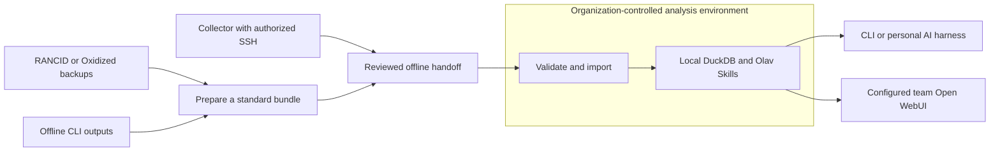

# Olav Skills

Olav Skills pairs seven standard network-analysis skills with a standalone Python runtime for **recorded, offline network data**. Use its CLI to import a capture, inspect devices and interfaces, query protocol relationships, compare snapshots and create evidence and diagrams. An existing AI harness can discover the skills and run the tools under its own permissions.

## How Olav fits into your network

Olav supports troubleshooting, change pre-checks, and audit handovers for network
operations and NetDevOps teams working with sensitive infrastructure. Collect on
the authorized side and transfer a reviewed copy into an analysis environment
your organization controls. Keep device credentials on the collection side.

- **Analyze locally.** Use the CLI on the local database or set up
  [Codex, Claude Code or Pi](harnesses.md). For an entirely local AI workflow,
  configure the model and retrieval to run locally and keep logs and generated
  reports within the approved environment. A remote model provider may receive
  prompt and tool context even when the database is local.
- **Work as a team.** A separately configured [Open WebUI integration](openwebui.md)
  gives authorized users browser access to recorded data and reports in their
  assigned tenant.
- **Prepare your inputs.** Use the [offline analysis guide](offline-data.md) for
  bundle validation and for the conversion required before importing backup
  repositories or loose CLI files.

## Start with a reproducible result

- **Olav Skills 0.2.2.** Install the pinned package, then import the synthetic bundle and check the exact device set R1/R2, a recorded CDP link and an R1 evidence fragment. [Installation](installation.md) · [Offline example](offline-data.md)
- **Review a local wheel.** Verify a supplied wheel and run the synthetic workflow, including data doctor and draft change-plan pre-checks. [Local wheel walkthrough](release-candidate.md)
- **AI harness setup.** Verify discovery, script execution and model answers independently. The tested Pi natural-question setup failed qualification. Codex and Claude Code natural questions were untested. [Harness setup](harnesses.md) · [Compatibility](reference/compatibility.md)

## Choose a skill

| Skill | Use it for |
| --- | --- |
| [netops](skills/netops.md) | Navigate the pack; shared command search and snapshot/config differences |
| [importer](skills/importer.md) | Survey, validate and ingest offline files; review parser coverage |
| [analyzer](skills/analyzer.md) | Bounded statistics, SQL, device/interface inspection and draft change plans |
| [topology](skills/topology.md) | Recorded BGP, OSPF and L2 relationships; declarative recipes |
| [reporter](skills/reporter.md) | Trace findings to bounded source fragments and comparisons |
| [writer](skills/writer.md) | Scoped draw.io/Mermaid diagrams and table-to-SVG conversion |
| [learner](skills/learner.md) | Prepare, test and persist CLI parsers with reviewed samples |

## What the evidence means

A snapshot describes observations in the supplied files. Inventory and observed snapshot membership differ. A device role may be unknown; a missing protocol view is a data gap. Collection time, import time and record update time are separate clocks. A bounded preview is not a full export. Read the [data model](data-model.md), [safety boundaries](safety.md) and [result protocol](reference/scripts.md) before making operational decisions.

The harness supplies model sessions, orchestration, permissions and execution tools. Collector handles device collection as a separate product. Use an authorized, reviewed capture with the local runtime once you have tried the synthetic workflow.

See [compatibility](reference/compatibility.md) for verified levels, [migration](migration.md) for legacy environments and the [historical documentation archive](legacy-index.md) for the former platform. The existing [license](license.md) remains applicable.
