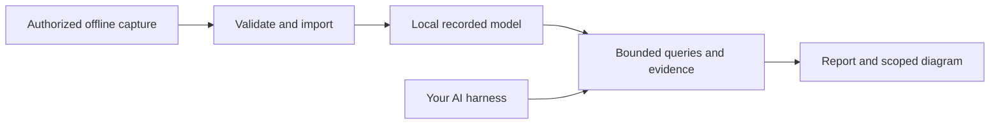

# Olav Skills

Olav Skills gives your existing AI harness network knowledge and deterministic Python tools for **recorded, offline network data**. Import a capture, inspect devices and interfaces, query protocol relationships, compare snapshots and create evidence and diagrams. The current public package is **`olav-skills` 0.1.1**, published on PyPI on 17 November 2026. Python imports use `olav_skills`; the CLI is `olav-skills`.

## Start with a reproducible result

1. [Install a dedicated Python environment](installation.md). No model key is required for deterministic tools.
2. [Run the complete offline example](offline-data.md). It checks the exact device set R1/R2, one recorded CDP link and an R1 evidence fragment, then writes a diagram and report.
3. [Bind your harness](harnesses.md), or keep using stdin JSON directly. Skill discovery, script execution and model answers have separate validation requirements.
4. Transfer a reviewed, authorized capture from the separate Collector product and import it into a new analysis root.

## Choose a skill

| Skill | Use it for |
| --- | --- |
| [netops](skills/netops.md) | Navigate the pack; shared command search and snapshot/config differences |
| [importer](skills/importer.md) | Survey, validate and ingest offline files; review parser coverage |
| [analyzer](skills/analyzer.md) | Bounded statistics, SQL, device/interface inspection and draft change plans |
| [topology](skills/topology.md) | Recorded BGP, OSPF and L2 relationships; declarative recipes |
| [reporter](skills/reporter.md) | Trace findings to bounded source fragments and comparisons |
| [writer](skills/writer.md) | Scoped draw.io/Mermaid diagrams and table-to-SVG conversion |
| [learner](skills/learner.md) | Prepare, test and persist CLI parsers with reviewed samples |

## What the evidence means

A snapshot describes observations in the supplied files. Inventory and observed snapshot membership differ. A device role may be unknown; a missing protocol view is a data gap. Collection time, import time and record update time are separate clocks. A bounded preview is not a full export. Read the [data model](data-model.md), [safety boundaries](safety.md) and [result protocol](reference/scripts.md) before making operational decisions.

The harness supplies the model, conversation, permissions and execution tools. This package supplies no model session manager, memory service, automatic learning loop, workflow engine or simulator. Collector and the private Open WebUI integration are separate products with their own access and deployment boundaries. Installing Skills does not connect to devices or grant access to them.

See [compatibility](reference/compatibility.md) for verified levels, [migration](migration.md) for legacy environments and the [historical documentation archive](legacy-index.md) for the former platform. The existing [license](license.md) remains applicable.
