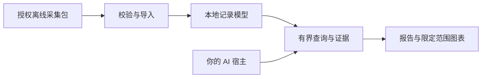

# Olav Skills

Olav Skills 为你已有的 AI 宿主提供网络领域知识，以及处理**已记录离线网络数据**的确定性 Python 工具。你可以导入采集文件、检查设备与接口、查询协议关系、比较快照，并输出证据和图表。当前公开包是 **`olav-skills` 0.1.1**，于 2026 年 11 月 17 日发布到 PyPI；Python 导入名为 `olav_skills`，命令为 `olav-skills`。

## 从可复现结果开始

1. [通过 pip 安装并绑定 harness](installation.md)。确定性工具不需要模型密钥。
2. [运行完整离线示例](offline-data.md)。示例核对 R1/R2 精确设备集合、一条已记录 CDP 链路及 R1 证据片段，再生成图表和报告。
3. [检查宿主技能发现](harnesses.md)，也可以继续直接传入 stdin JSON。技能发现、脚本执行、模型回答分别需要验证。
4. 从独立 Collector 产品取得经授权审阅的采集包，在新的分析根目录导入。

## 选择技能

| 技能 | 用途 |
| --- | --- |
| [netops](skills/netops.md) | 技能导航、共享命令搜索、快照及配置差异 |
| [importer](skills/importer.md) | 调查、校验和导入离线文件，审阅解析覆盖率 |
| [analyzer](skills/analyzer.md) | 有界统计、SQL、设备与接口检查、变更草案 |
| [topology](skills/topology.md) | 已记录 BGP、OSPF、二层关系及声明式 recipe |
| [reporter](skills/reporter.md) | 将结论关联到有界原始证据片段和比较结果 |
| [writer](skills/writer.md) | 限定范围 draw.io/Mermaid 图及表格转 SVG |
| [learner](skills/learner.md) | 根据审阅样本准备、测试并保存 CLI 解析器 |

## 证据代表什么

快照描述输入文件中的观测。设备台账与快照观测成员不同；角色可能未知，协议视图缺失表示数据缺口。采集时间、导入时间和记录更新时间是不同的时钟。有界预览也不是完整导出。进行运维判断前，请阅读[数据模型](data-model.md)、[安全边界](safety.md)及[结果协议](reference/scripts.md)。

模型、对话、权限及执行工具由宿主提供。本包没有模型会话管理器、记忆服务、自动学习循环、工作流引擎或模拟器。Collector 与私有 Open WebUI 集成是独立产品，有各自的访问和部署边界。安装技能不会连接设备或授予设备权限。

[兼容性](reference/compatibility.md)列出实际验证层级；旧环境请读[迁移指南](migration.md)，旧平台资料见[历史手册](legacy-index.md)。现有[许可证](license.md)继续适用。
