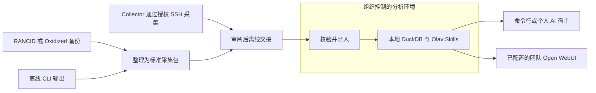

# Olav Skills

Olav Skills 提供七个标准网络分析 Skill 和独立 Python runtime，用于处理**已记录的离线网络数据**。通过 CLI 可以导入采集包、检查设备与接口、查询协议关系、比较快照，并输出证据和图表。已有 AI 宿主可发现这些技能，并在自身权限范围内运行工具。

## OLAV 如何接入你的网络

OLAV 面向处理敏感网络数据的运维和 NetDevOps 团队，用于故障排查、变更预检和审计交接。在获准访问设备的一侧采集，只把审阅后的副本交给组织控制的分析环境。设备凭据留在采集侧。

- **本地分析。** 直接使用命令行查询本地数据库，或[接入 Codex、Claude Code 或 Pi](harnesses.zh.md)。要让 AI 工作流全程本地运行，需要把模型和检索配置在本地，并将日志和报告保存在获准的环境中。即使数据库在本地，远程模型供应商也可能收到提示词和工具结果。
- **团队协作。** 单独配置的 [Open WebUI 集成](openwebui.zh.md)允许获授权的用户在浏览器查看所分配租户的网络记录和报告。
- **准备输入。** [离线分析指南](offline-data.zh.md)说明如何校验标准包，以及备份仓库和散落的 CLI 文件在导入前需要怎样转换。

## 从可复现结果开始

- **Olav Skills 0.2.2。** 安装指定版本后，导入合成包并核对 R1/R2 精确设备集合、一条 CDP 链路记录和一条 R1 证据片段。[安装](installation.zh.md) · [离线示例](offline-data.zh.md)
- **审阅本地 wheel。** 校验提供的 wheel，运行合成流程、数据体检和变更草案预检。[本地 wheel 示例](release-candidate.zh.md)
- **接入 AI 宿主。** 分别验证技能发现、脚本执行与模型回答。已测试的 Pi 配置未通过自然问答验收，Codex 和 Claude Code 自然问答未测。[宿主接入](harnesses.zh.md) · [兼容性](reference/compatibility.zh.md)

## 选择技能

| 技能 | 用途 |
| --- | --- |
| [netops](skills/netops.md) | 技能导航、共享命令搜索、快照及配置差异 |
| [importer](skills/importer.md) | 调查、校验和导入离线文件，审阅解析覆盖率 |
| [analyzer](skills/analyzer.md) | 有界统计、SQL、设备与接口检查、变更草案 |
| [topology](skills/topology.md) | 已记录 BGP、OSPF、二层关系及声明式 recipe |
| [reporter](skills/reporter.md) | 将结论关联到有界原始证据片段和比较结果 |
| [writer](skills/writer.md) | 限定范围 draw.io/Mermaid 图及表格转 SVG |
| [learner](skills/learner.md) | 根据审阅样本准备、测试并保存 CLI 解析器 |

## 证据代表什么

快照描述输入文件中的观测。设备台账与快照观测成员不同；角色可能未知，协议视图缺失表示数据缺口。采集时间、导入时间和记录更新时间是不同的时钟。有界预览也不是完整导出。进行运维判断前，请阅读[数据模型](data-model.md)、[安全边界](safety.md)及[结果协议](reference/scripts.md)。

模型会话、编排、权限与工具执行由宿主提供。设备采集由独立的 Collector 产品处理。完成合成示例后，可把经授权审阅的离线采集包交给本地 runtime 分析。

[兼容性](reference/compatibility.zh.md)列出实际验证层级；旧环境请读[迁移指南](migration.md)，旧平台资料见[历史手册](legacy-index.md)。现有[许可证](license.md)继续适用。
