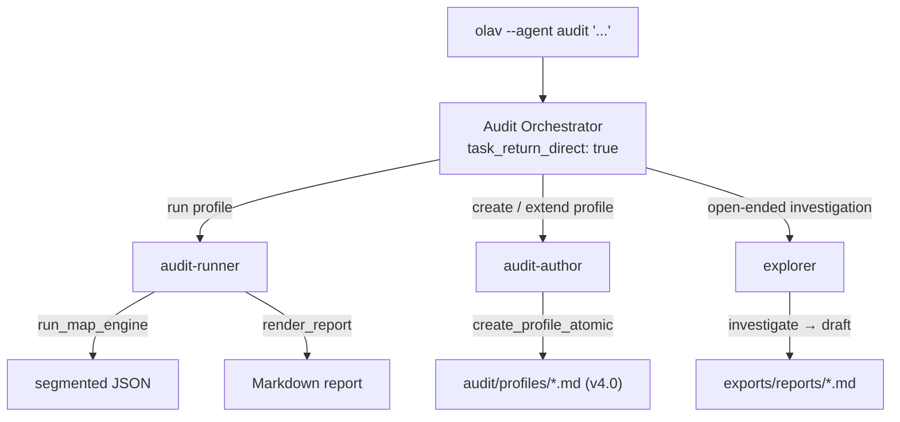

# Audit Agent

The Audit Agent creates and executes reusable health-check profiles. Combined with the **explorer** sub-agent (an audit sub-agent since 2026-05-19) (LLM-driven discovery) and the system cron (scheduled inspection), it closes the **discover → freeze → recurring inspection** loop.

!!! abstract "Feature Claims"
    | ID | Claim | Status |
    |----|-------|--------|
    | C-NE-32 | `olav --agent audit "create BGP health check"` guides profile creation | ✅ v0.13.1 |
    | C-NE-33 | `olav --agent audit "run bgp-health audit"` produces a Markdown health report | ✅ v0.13.1 |
    | C-NE-34 | Profile Authoring validates table and column names exist before writing SQL | ✅ v0.10.0 |
    | C-NE-35 | `analyze_thresholds` provides P50/P90/P95 statistical recommendations | ✅ v0.13.1 |
    | C-NE-36 | Multi-job profile: a single file can contain multiple independent SQL checks | ✅ v0.18.1 |
    | C-NE-37 | Post-Check Playbook auto-generates SSH follow-up commands for breached devices | ✅ v0.19.0 (see "Post-Check Playbook") |

---

## Architecture (v0.19+, three sub-agents)

!!! note "Round 259 split (v0.19.0, 2026-05-11) + explorer migration (2026-05-19)"
    The former dual-mode `audit-auditor` was split into two focused sub-agents,
    and the open-ended investigation capability moved in from netops:
    * **audit-runner** — execution only (`run_map_engine` + `render_report`, deterministic 2-step pipeline)
    * **audit-author** — profile writing only (`create_profile_atomic` / `write_profile`, Pydantic-typed structured output; `write_profile` mode=create|extend)
    * **explorer** — open-ended network health investigation (senior-architect persona, free-form discovery → markdown report). Migrated from `netops/explorer` on 2026-05-19; the earlier `curator` sub-agent was removed. Parser/schema auto-learn is **not** an audit concern — it lives in the `netops/learner` sub-agent.

Narrower tool sets per sub-agent, shorter SKILL.md, fewer decision points for small models.



| Sub-agent | Tools | Role |
|---|---|---|
| **audit-runner** | `run_map_engine`, `render_report`, `olav_recall_memory` | Run one profile → produce a report |
| **audit-author** | `create_profile_atomic`, `write_profile`, `list_profiles`, `load_profile`, `test_map_query`, `analyze_thresholds`, `execute_skill_script`, `olav_recall_memory`, `read_file`* | Write profiles (incl. from an explorer markdown report) |
| **explorer** | `execute_sql`, `query_evidence`, `execute_skill_script`, `olav_recall_memory` | Open-ended health investigation → markdown draft the author can promote to a profile |

*`read_file` is allowed only on `exports/reports/**` (FilesystemPermission allow-rule), used to read Explorer drafts.

---

## Full lifecycle: discover → freeze → recurring inspection

```
[one-shot]   Explorer (LLM-driven discovery)
   olav --agent netops "Run a wireless / physical-layer / routing audit"
   ↓ 18-30 min (depending on the model's speed)
   exports/reports/explore_<run_id>.md   ← free-form markdown, multiple findings
   ↓
[human review] Read report, pick findings worth permanent monitoring
   ↓
[one-shot]   Audit Author (structured)
   olav --agent audit "Create wireless_health profile from explore_xxx.md
                       with N jobs: AP concentration, Wi-Fi 5 migration debt,
                       stale APs..."
   ↓ ~2 min
   audit/profiles/<name>.md   ← v4.0 YAML frontmatter + jobs[]
   ↓
[one-shot]   Scheduling
   olav "Schedule wireless_health to run daily at 06:00"
   ↓
   crontab adds: 0 6 * * * olav --agent audit "run wireless_health" ...
   ↓
[recurring] cron triggers Audit Runner (no LLM reasoning, just SQL + one
            narration call)
   ↓ ~2 min per run
   exports/audit_reports/wireless_health_<date>.md  ← Critical/Warning/Info
                                                      tables + cross-job
                                                      summary + Priority 2b
                                                      auto-follow-up SSH cmds
```

See the [Scheduling guide](../../guides/scheduling.md) for the cron half.

---

## Creating a Profile

### Path A: from natural language (simplest)

```bash
olav --agent audit "Create a BGP health check profile"
```

The author sub-agent (Profile Authoring mode) walks you through:

1. **What to check** — which tables/views (e.g. `v_bgp_neighbors_auto`)
2. **Schema validation** — table/column names verified against DuckDB before writing any SQL
3. **SQL query** — parameterized, `:window` placeholder for time range
4. **Thresholds** — optional: `analyze_thresholds` pulls P50/P90/P95 from historical data
5. **Save** — profile written as YAML frontmatter + Markdown to `audit/profiles/<name>.md`

### Path B: from an Explorer markdown report

```bash
# 1. Let the Explorer do a discovery run first
olav --agent netops "Run an autonomous wireless audit on snapshot <id>"
# Output: exports/reports/explore_<run_id>.md

# 2. Hand the report to the author (ideal flow)
olav --agent audit "Read exports/reports/explore_<run_id>.md
                    and create a multi-job wireless_health profile."
```

!!! warning "Known operator friction (v0.19.0)"
    On small local models like gemma4:31b, the author sub-agent **refuses to call `read_file`** — it prefers `execute_skill_script` and other workarounds. All infrastructure layers (FilesystemPermission allow rule + SKILL.md whitelist + Hard Constraints exception) are in place, but the model's adherence is the blocker.

    **Verified workaround** — inline the SQL into the prompt:

    ```bash
    olav --agent audit 'Create v4.0 profile "wireless_health" via create_profile_atomic
    with 3 jobs:
      Job 1: name=AP_CONCENTRATION_PER_SWITCH, query=<SQL from finding 1>...
      Job 2: name=WIFI_5_MIGRATION_DEBT,       query=<SQL from finding 2>...
      Job 3: name=STALE_AP_NEIGHBORS,          query=<SQL from finding 3>...'
    ```

    Higher-adherence models (claude-* / grok-4.1-fast) should be able to use `read_file` directly.

### Profile format (v4.0)

```yaml
---
name: wireless_health
version: '4.0'
persist_findings_to_db: true
max_findings_per_job: 50
jobs:
- name: AP_CONCENTRATION_PER_SWITCH
  type: sql
  severity: Warning
  section_prompt: List access switches by attached AP count.
                  Critical >40, Warning >25.
  query: SELECT device_name as device,
                COUNT(*) as metric_value,
                'AP Count' as metric_name,
                CASE WHEN COUNT(*) > 40 THEN 'Critical'
                     WHEN COUNT(*) > 25 THEN 'Warning'
                     ELSE 'Info' END as severity_hint
         FROM netops.v_show_cdp_neighbors_detail_auto
         WHERE platform LIKE '%AIR-AP%'
            OR platform LIKE '%C91%'
            OR platform LIKE '%CW91%'
         GROUP BY device_name
         HAVING COUNT(*) > 5
         ORDER BY metric_value DESC
         LIMIT 50
- name: WIFI_5_MIGRATION_DEBT
  ...
---
```

Four conventions:

- SELECT must emit `device` / `metric_value` / `metric_name` / `severity_hint` columns (drives Post-Check Playbook)
- `severity_hint` ∈ {Critical, Warning, Info}
- `HAVING` filters out irrelevant rows but `LIMIT` leaves headroom for threshold-distribution observation
- A single profile can hold multiple jobs (one domain = one profile, many checks inside)

---

## Running an Audit

```bash
olav --agent audit "Run the wireless_health profile, last 24h"
```

The runner sub-agent executes a two-stage pipeline:

### Stage 1: Map (`run_map_engine`) — pure Python, seconds

- Load profile YAML
- Execute each job's SQL with DuckDB named-parameter binding (NO string interpolation — injection-proof)
- Collect results, honor `max_findings_per_job`
- Output segmented JSON (one section per job)
- ~1-2 seconds typical

### Stage 2: Render (`render_report`) — one LLM call, 60-90 sec

- Each job's findings rendered as a Markdown table + LLM narration
- Cross-job correlation: Executive Summary spans all jobs
- **Post-Check Playbook** section: auto-generated follow-up SSH commands for breached devices (see below)

---

## Post-Check Playbook (v0.19.0 rewrite)

The "what to investigate next" section appended to every audit report. **Deterministically Python-built**, no LLM:

### Priority 1 — Incident Clusters (topology root-cause confirmed)

Pulled from `audit_json.incident_clusters` (already identified by `incident_engine`). Emits networkx topology-simulation prompts.

### Priority 2 — Device-level verification (built-in job types)

Matches against the `PRIORITY_JOBS` allow-list (`BGP_Not_Established` / `Interface_Down` / `OSPF_Drift` / `CPU_Anomaly` / ...). For each match, calls the corresponding `_ops_prompt_*` builder to emit a device + problem-class-specific SSH command.

### Priority 2b — Threshold Breaches (Custom Metrics) ⭐ new in v0.19.0

For jobs **not** in the built-in list (e.g. wireless / physical custom checks promoted from an explorer finding), groups each job's `severity_hint ∈ {Critical, Warning}` devices, sorts by severity → metric_value desc, emits:

```
**1.** `foo2-ts4-3850-3.net.vu.edu.au TenGigabitEthernet3/0/4` — TOP_HIGH_ERROR_INTERFACES: input_errors=947644166 (Critical)

```bash
olav -a netops "Investigate foo2-ts4-3850-3.net.vu.edu.au TenGigabitEthernet3/0/4:
             input_errors=947644166 (Critical). Verify data freshness,
             use networkx to assess whether the surrounding topology can
             absorb a redistribution, and output a recovery sequence."
```
```

!!! note "Priority 2b fix (2026-05-16)"
    Earlier versions only picked alphabetically-first 5 devices through the Priority 3 generic-health-check path, so Info-level devices drowned the actual Critical/Warning ones. v0.19.0 fix: filter by severity first, then sort, then take top-N per job. For multi-job profiles, Priority 2b aggregates breach lists across all jobs.

### Priority 3 — General Health Check (remaining severity-bearing devices)

For devices not surfaced in Priority 1/2/2b but still carrying a `severity_hint`, emit a generic quick-health-check command (show logging / show interfaces summary / show processes cpu).

---

## Example Report

See actual production output under `exports/audit_reports/wireless_ap_concentration_*.md`:

```markdown
## Executive Summary

The inspection identified high AP density across several access switches.
Specifically, foo-ehs2-9300-4.net.vu.edu.au is reported as 🔴 Critical with
an AP count of 41. Additionally, ten devices are flagged as ⚠️ Warning...

**Network Health: 🔴 Critical**

---

## Access Switch AP Density

| Device                       | Check Item | Current Value | Notes        |
|------------------------------|------------|---------------|--------------|
| foo-ehs2-9300-4.net.vu.edu.au| AP Count   | 41            | 🔴 Critical  |
| QS4-B1S1-EDGE.net.vu.edu.au  | AP Count   | 32            | ⚠️ Warning   |
| ... 9 more

---

## 🔁 Post-Check Playbook

### Priority 2b — Threshold Breaches (Custom Metrics)

**1.** `foo-ehs2-9300-4.net.vu.edu.au` — AP_CONCENTRATION_PER_SWITCH: AP Count=41 (Critical)
    olav -a netops "Investigate foo-ehs2-9300-4: AP Count=41 (Critical) ..."

**2-N.** ...
```

---

## Tool Cheat-sheet

### audit-runner tools

| Tool | Purpose |
|---|---|
| `run_map_engine` | Run every SQL job in a profile, output segmented JSON |
| `render_report` | Render Markdown report + generate Post-Check Playbook |
| `olav_recall_memory` | Optional: recall related audit-run memories |

### audit-author tools

| Tool | Purpose |
|---|---|
| `create_profile_atomic` | One-call create (schema verify + per-SQL validate + write) |
| `write_profile` | Create (mode=create) or extend (mode=extend) a profile — overwrite waits on a HITL gate |
| `list_profiles` | List all profiles on disk |
| `execute_skill_script` | Run a skill script (bridge to deterministic scripts) |
| `read_file` | Read `exports/reports/**` only — for explorer drafts (FilesystemPermission allow) |

### explorer tools

| Tool | Purpose |
|---|---|
| `execute_sql` | Read-only DuckDB queries against the network state |
| `query_evidence` | Unified text search across syslog / command output / config |
| `execute_skill_script` | Run an investigation skill script |
| `olav_recall_memory` | Recall prior findings / expert knowledge |

> Schema/parser auto-learn (`fuzzy_map_schema`, `discover_view_schemas`,
> `trace_learner`) is **not** an audit capability — it belongs to the
> `netops/learner` sub-agent. The old `curator` audit sub-agent that
> bundled those was removed 2026-05-19.

---

## Relation to Explorer

Explorer (the audit **explorer** sub-agent) and recurring **profiles** are **complementary**:

| Property | Explorer | Audit |
|---|---|---|
| Trigger | One-shot user question | Recurring cron / manual run |
| Decision authority | LLM picks investigation directions | Profile pins SQL forever |
| Cost | High (18-30 min, LLM per step) | Low (~2 min, one narration call) |
| Output | Free-form markdown + DB findings rows | Structured Markdown report, diffable across runs |
| Use case | First touch / find new problems | Recurring monitoring of known problems |

Design philosophy: **Explorer uses one-shot LLM freedom to find problems; Audit freezes the found problems into repeatable, diffable, zero-freedom inspections**.
