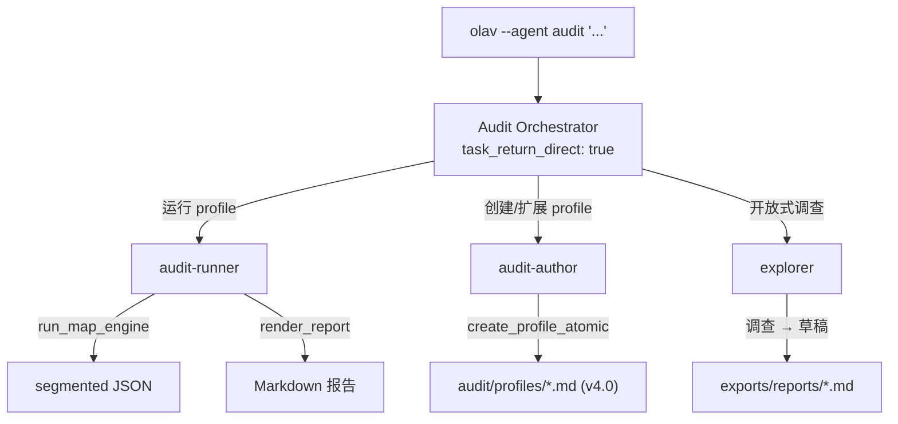

# Audit Agent

Audit Agent 创建并执行可复用的健康检查 Profile，配合 **explorer** 子 agent（audit 自带，LLM 自主发现）和系统 cron（定时巡检），形成 **发现 → 固化 → 周期巡检** 的完整闭环。

!!! abstract "功能声明"
    | ID | 声明 | 状态 |
    |----|------|------|
    | C-NE-32 | `olav --agent audit "创建 BGP 健康检查"` 引导 Profile 创建 | ✅ v0.13.1 |
    | C-NE-33 | `olav --agent audit "执行 bgp-health 审计"` 输出 Markdown 健康报告 | ✅ v0.13.1 |
    | C-NE-34 | Profile Authoring 在写入 SQL 前验证表名和列名真实存在 | ✅ v0.10.0 |
    | C-NE-35 | `analyze_thresholds` 提供 P50/P90/P95 统计推荐值 | ✅ v0.13.1 |
    | C-NE-36 | 多 job profile：单文件包含多个独立 SQL 检查 | ✅ v0.18.1 |
    | C-NE-37 | Post-Check Playbook 自动生成针对越界设备的 SSH follow-up 命令 | ✅ v0.19.0（修复见 §"Post-Check Playbook"）|

---

## 架构（v0.19+ 三 sub-agent）

!!! note "Round 259（v0.19.0, 2026-05-11）拆分"
    `audit-auditor` 双模式拆成两个专注 sub-agent：
    * **audit-runner** — 仅执行（`run_map_engine` + `render_report`，两步确定性流水线）
    * **audit-author** — 仅写 Profile（`create_profile_atomic` / `write_profile`，Pydantic 结构化输出；`write_profile` mode=create|extend）
    * **explorer** — 开放式网络健康调查（资深架构师人设，自由探索 → markdown 报告）。2026-05-19 由 `netops/explorer` 迁入；旧的 `curator` 子 agent 已移除。解析器/schema 自动学习**不属于** audit —— 它在 `netops/learner` 子 agent。

每个 sub-agent 工具集更窄、SKILL.md 更短，小模型的决策点减少。



| Sub-agent | 工具 | 角色 |
|---|---|---|
| **audit-runner** | `run_map_engine`, `render_report`, `olav_recall_memory` | 跑一次 profile 出报告 |
| **audit-author** | `create_profile_atomic`, `write_profile`, `list_profiles`, `load_profile`, `test_map_query`, `analyze_thresholds`, `execute_skill_script`, `olav_recall_memory`, `read_file`* | 写 profile（含从 explorer markdown 提取）|
| **explorer** | `execute_sql`, `query_evidence`, `execute_skill_script`, `olav_recall_memory` | 开放式健康调查 → markdown 草稿，author 可提升为 profile |

*`read_file` 仅对 `exports/reports/**` 开放（FilesystemPermission 白名单），用于读 Explorer 草案。

---

## 完整生命周期：发现 → 固化 → 周期巡检

```
[一次性] Explorer（LLM 自由发现）
   olav --agent netops "做一次无线 / 物理层 / 路由 / ... 自主审计"
   ↓ 18-30 min（依模型速度）
   exports/reports/explore_<run_id>.md   ← 自由格式 markdown，多发现
   ↓
[人类决策] 阅读报告，选要长期监控的发现
   ↓
[一次性] Audit Author（结构化）
   olav --agent audit "从 explore_xxx.md 创建 wireless_health profile，
                       含 N 个 job：AP 集中度、Wi-Fi 5 迁移债、stale APs..."
   ↓ ~2 min
   audit/profiles/<name>.md   ← v4.0 YAML frontmatter + jobs[]
   ↓
[一次性] Scheduling
   olav "为 wireless_health profile 加个每天 6:00 的 cron"
   ↓
   crontab 加一行：0 6 * * * olav --agent audit "run wireless_health" ...
   ↓
[周期] cron 触发 Audit Runner（无 LLM 推理，纯 SQL + 一次 narration 调用）
   ↓ ~2 min/次
   exports/audit_reports/wireless_health_<date>.md   ← Critical/Warning/Info 表格 + 跨 job summary
                                                       + Priority 2b 自动 follow-up SSH 命令
```

定时部分参见 [调度指南](../../guides/scheduling.md){:title='guides/scheduling'}。

---

## 创建 Profile

### 方式 A：从自然语言（最简）

```bash
olav --agent audit "创建一个 BGP 健康检查 Profile"
```

author 子 agent（Profile Authoring 模式）引导：

1. **查什么** — 哪些表/视图（如 `v_bgp_neighbors_auto`）
2. **Schema 验证** — 写入 SQL 前验证表名/列名存在于 DuckDB
3. **SQL 查询** — 参数化查询，`:window` 占位符用于时间范围
4. **阈值** — 可选：`analyze_thresholds` 从历史数据获取 P50/P90/P95 推荐
5. **保存** — Profile 以 YAML frontmatter + Markdown 格式写入 `audit/profiles/<name>.md`

### 方式 B：从 Explorer markdown 报告

```bash
# 1. Explorer 先做一次自主发现
olav --agent netops "做一次无线层自主审计 on snapshot <id>"
# 输出: exports/reports/explore_<run_id>.md

# 2. 把报告交给 author（理想情况）
olav --agent audit "Read exports/reports/explore_<run_id>.md
                    and create a multi-job wireless_health profile."
```

!!! warning "已知运维摩擦（v0.19.0）"
    在 gemma4:31b 等小本地模型上，author 子 agent **拒绝调用 `read_file`** —— 它会偏好 `execute_skill_script` 等其它工具。基础设施层（FilesystemPermission allow + SKILL.md 白名单 + Hard Constraints 例外）都到位了，但模型依从性是 LLM 层问题。

    **Workaround（验证可工作）**：把 SQL inline 进 prompt：

    ```bash
    olav --agent audit 'Create v4.0 profile "wireless_health" via create_profile_atomic
    with 3 jobs:
      Job 1: name=AP_CONCENTRATION_PER_SWITCH, query=<SQL from report finding 1>...
      Job 2: name=WIFI_5_MIGRATION_DEBT, query=<SQL from report finding 2>...
      Job 3: name=STALE_AP_NEIGHBORS, query=<SQL from report finding 3>...'
    ```

    换更高依从性的模型（claude-* / grok-4.1-fast）应该可以走 `read_file` 直接读报告。

### Profile 格式（v4.0）

```yaml
---
name: wireless_health
version: '4.0'
persist_findings_to_db: true
max_findings_per_job: 50
jobs:
- name: AP_CONCENTRATION_PER_SWITCH
  type: sql
  severity: Warning
  section_prompt: List access switches by attached AP count.
                  Critical >40, Warning >25.
  query: SELECT device_name as device,
                COUNT(*) as metric_value,
                'AP Count' as metric_name,
                CASE WHEN COUNT(*) > 40 THEN 'Critical'
                     WHEN COUNT(*) > 25 THEN 'Warning'
                     ELSE 'Info' END as severity_hint
         FROM netops.v_show_cdp_neighbors_detail_auto
         WHERE platform LIKE '%AIR-AP%'
            OR platform LIKE '%C91%'
            OR platform LIKE '%CW91%'
         GROUP BY device_name
         HAVING COUNT(*) > 5
         ORDER BY metric_value DESC
         LIMIT 50
- name: WIFI_5_MIGRATION_DEBT
  ...
---
```

四个**关键约定**：
- SELECT 必须输出 `device` / `metric_value` / `metric_name` / `severity_hint` 列（驱动 Post-Check Playbook）
- `severity_hint` ∈ {Critical, Warning, Info}
- `HAVING` 过滤掉无关行，但 LIMIT 留够给阈值分布观察用
- 一个 profile 可以装多个 job（一个领域一个 profile，含多检查项）

---

## 运行审计

```bash
olav --agent audit "运行 wireless_health profile，最近 24 小时"
```

runner 子 agent 执行两阶段流水线：

### 阶段 1：Map（`run_map_engine`）— 纯 Python，秒级

- 加载 Profile YAML
- 用 DuckDB 命名参数绑定执行每个 job 的 SQL（**不**做字符串插值，杜绝注入）
- 收集结果，遵守 `max_findings_per_job`
- 输出分段 JSON（每个 job 一个 section）
- 时间约 1-2 秒（取决于数据量）

### 阶段 2：Render（`render_report`）— 一次 LLM 调用，60-90 秒

- 对每个 job 渲染 Markdown 表格 + LLM narration
- 关联分析：跨 job 综合 Executive Summary
- **Post-Check Playbook** 段：自动生成针对越界设备的 follow-up SSH 命令（见下）

---

## Post-Check Playbook（v0.19.0 重写）

每次 audit 报告末尾自动生成的"接下来怎么排查"段落。**纯 Python 确定性构造**，没有 LLM 介入：

### Priority 1 — Incident Clusters（拓扑根因已确认）

来自 `audit_json.incident_clusters`（incident_engine 已识别的集群），生成 networkx 拓扑模拟命令。

### Priority 2 — 设备级验证（内置 job 类型）

匹配 `PRIORITY_JOBS` 内置列表（`BGP_Not_Established` / `Interface_Down` / `OSPF_Drift` / `CPU_Anomaly` / ...）的 job，用对应的 `_ops_prompt_*` builder 出针对该设备 + 该问题类型的 SSH 排查命令。

### Priority 2b — 阈值越界（自定义指标）⭐ v0.19.0 新增

对**未在内置列表**的 job（如 explorer 固化的 wireless / physical 自定义检查），自动汇总每个 job 中 `severity_hint ∈ {Critical, Warning}` 的设备，按严重度 → metric 值降序排序，每个生成：

```
**1.** `foo2-ts4-3850-3.net.vu.edu.au TenGigabitEthernet3/0/4` — TOP_HIGH_ERROR_INTERFACES: input_errors=947644166 (Critical)

```bash
olav -a netops "Investigate foo2-ts4-3850-3.net.vu.edu.au TenGigabitEthernet3/0/4:
             input_errors=947644166 (Critical). Verify data freshness,
             use networkx to assess whether the surrounding topology can
             absorb a redistribution, and output a recovery sequence."
```
```

!!! note "Priority 2b 修复（2026-05-16）"
    早期版本只挑 alphabetically-first 5 个 device 走 Priority 3 通用 health-check 通道，导致 Info 级 device 排在前面、真正 Critical 的设备被淹没。v0.19.0 修复：先按 severity 过滤再排序，每个 job 各自出 5 条。多 job profile 的 Priority 2b 会汇总跨 job 的 Critical/Warning 列表。

### Priority 3 — 通用健康确认（剩余 severity 设备）

未在 Priority 1/2/2b 中出现且仍有 severity_hint 的 device，给一个通用 quick health check 命令（show logging / show interfaces summary / show processes cpu）。

---

## 报告示例

参见 `exports/audit_reports/wireless_ap_concentration_*.md` 实际生产输出：

```markdown
## Executive Summary

The inspection identified high AP density across several access switches.
Specifically, foo-ehs2-9300-4.net.vu.edu.au is reported as 🔴 Critical with
an AP count of 41. Additionally, ten devices are flagged as ⚠️ Warning...

**Network Health: 🔴 Critical**

---

## Access Switch AP Density

| Device                       | Check Item | Current Value | Notes        |
|------------------------------|------------|---------------|--------------|
| foo-ehs2-9300-4.net.vu.edu.au| AP Count   | 41            | 🔴 Critical  |
| QS4-B1S1-EDGE.net.vu.edu.au  | AP Count   | 32            | ⚠️ Warning   |
| ... 9 more

---

## 🔁 Post-Check Playbook

### Priority 2b — Threshold Breaches (Custom Metrics)

**1.** `foo-ehs2-9300-4.net.vu.edu.au` — AP_CONCENTRATION_PER_SWITCH: AP Count=41 (Critical)
    olav -a netops "Investigate foo-ehs2-9300-4: AP Count=41 (Critical) ..."

**2-N.** ...
```

---

## 工具速查

### audit-runner 工具

| 工具 | 用途 |
|---|---|
| `run_map_engine` | 跑 profile 的所有 SQL job，输出 segmented JSON |
| `render_report` | 渲染 Markdown 报告 + 生成 Post-Check Playbook |
| `olav_recall_memory` | 可选：召回过往 audit run 的关联记忆 |

### audit-author 工具

| 工具 | 用途 |
|---|---|
| `create_profile_atomic` | 单次创建 profile（含 schema 验证 + per-SQL 校验 + 写盘）|
| `write_profile` | 创建（mode=create）或扩展（mode=extend）profile —— 覆盖需过 HITL gate |
| `list_profiles` | 列出所有已有 profile |
| `execute_skill_script` | 跑 skill script（桥接确定性脚本）|
| `read_file` | 读 `exports/reports/**` 下的 explorer 报告（受 FilesystemPermission 限制）|

### explorer 工具

| 工具 | 用途 |
|---|---|
| `execute_sql` | 对网络状态做只读 DuckDB 查询 |
| `query_evidence` | syslog / 命令输出 / 配置 的统一文本检索 |
| `execute_skill_script` | 跑调查类 skill script |
| `olav_recall_memory` | 召回过往发现 / 专家知识 |

> schema/解析器自动学习（`fuzzy_map_schema`、`discover_view_schemas`、
> `trace_learner`）**不是** audit 能力 —— 它属于 `netops/learner` 子 agent。
> 旧的捆绑这些功能的 `curator` audit 子 agent 已于 2026-05-19 移除。

---

## 与 Explorer 的关系

Explorer（audit 的 **explorer** 子 agent）和周期性 **profile** 是**互补**的：

| 特征 | Explorer | Audit |
|---|---|---|
| 触发 | 用户一次性问题 | 周期 cron / 手动 run |
| 决策权 | LLM 自由选择调查方向 | Profile 固定 SQL 跑死 |
| 成本 | 高（18-30 min，每步 LLM 推理）| 低（~2 min，1 次 LLM narration）|
| 输出 | 自由格式 markdown + DB 里的 findings 行 | 结构化 Markdown 报告 + 可比对 |
| 适合场景 | 第一次接手 / 找新问题 | 已知问题的周期监控 |

设计哲学：**Explorer 用一次性 LLM 自由度找问题，Audit 把找到的问题固化成可重复、可 diff、零自由度的巡检**。
