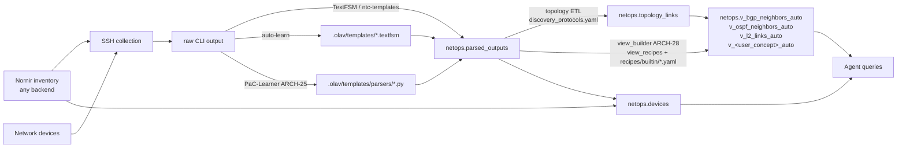
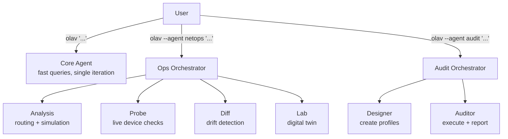

# Core Concepts

How OLAV NetOps collects, stores, and reasons about your network.

!!! abstract "Feature Claims"
    | ID | Claim | Status |
    |----|-------|--------|
    | C-NE-05 | Each snapshot produces a unique `snapshot_id` shared across all tables | ✅ v0.10.0 |
    | C-NE-06 | Custom TextFSM templates take priority over built-in NTC templates | ✅ v0.10.0 |
    | C-NE-07 | `CommandRegistry.reload()` picks up new templates without restart | ✅ v0.10.0 |

---

## Data Flow



Every collection run produces a **snapshot** — a point-in-time capture of all device state. Each row in the database carries a `snapshot_id` that ties it back to the exact collection moment.

A handful of YAML files + one DB table drive the whole pipeline. None of them live in Python code:

| File / table | Role |
|---|---|
| Nornir inventory (any backend) | Device list + `platform` + `hostname` + `environment` |
| `netops.commands` (DB table) | **Per-platform CLI command SSOT.** Auto-populated from ntc-templates filename scan at `/netops_init` Stage 0. Replaces the legacy `discovery_commands.yaml`. |
| `user_commands.yaml` | Backup-only raw captures (show run / show config) — workspace default + optional `~/.olav/config/` override |
| `discovery_protocols.yaml` | Neighbour-discovery protocols (CDP/LLDP/ISIS/custom) to extract |
| `platform_profiles.yaml` | Vendor display name + show-version field hints + Scrapli mapping |
| `recipes/builtin/*.yaml` + `~/.olav/config/recipes/user/*.yaml` | Canonical concept → raw field mappings that build SQL views |
| `~/.olav/config/topology.yaml` | User intent — which relationships to care about |

---

## Snapshot Model

A snapshot is the fundamental unit of network state. When you run `/netops_init` or trigger a manual collection, OLAV:

1. **Collects** — SSH to every device in `nornir/hosts.yaml`, runs all whitelisted show commands
2. **Parses** — Applies TextFSM templates to extract structured fields from raw CLI output
3. **Stores** — Writes parsed JSON arrays to `netops.parsed_outputs`, raw text to `netops.raw_output_store`
4. **Derives** — Auto-generates views (`v_*_auto`) and topology links from the parsed data

All rows from the same collection share the same `snapshot_id`. This makes time-series comparison simple: pick two snapshot IDs and diff any table.

---

## Batfish Snapshot Export

Every `/netops_init` run also writes a Batfish-compatible config snapshot on disk, so you can feed it straight into `pybatfish` or any Batfish-based analysis pipeline without re-parsing DuckDB:

```
exports/snapshots/<YYYY-MM-DD>/batfish/
├── configs/
│   ├── R1.cfg
│   ├── R2.cfg
│   └── SW1.cfg
└── snapshot.json        # provenance: generator, timestamp, device list
```

A `latest-batfish` symlink at `exports/snapshots/latest-batfish` always points at the most recent export. Per-platform "which command carries the running config" is resolved from `user_commands.yaml` (defaults match Batfish preferences — e.g. Junos uses `show configuration | display set`).

---

## TextFSM Template Priority

When parsing CLI output, OLAV looks for a matching template in this order:

| Priority | Location | Source |
|----------|----------|--------|
| 1 (highest) | `workspace/ops/config/textfsm/` | User-defined overrides |
| 2 | `workspace/ops/config/templates/custom/` | Generated by `/learn_cmd` |
| 3 | `workspace/ops/config/templates/` | Bundled defaults |
| 4 (lowest) | `ntc-templates` Python package | Community templates |

The first match wins. To override a built-in template, place a file with the same naming convention (`<platform>_<command>.textfsm`) in priority 1 or 2.

---

## Agent Hierarchy



| Agent | When to use | Device access? |
|-------|------------|---------------|
| **Quick** | Simple questions, daily lookups | Yes (single CLI) |
| **Ops → Analysis** | What-if simulation, path analysis | No (pure computation) |
| **Ops → Probe** | Batch liveness checks, parallel CLI | Yes (parallel) |
| **Ops → Diff** | Compare two snapshots for changes | No (DB queries) |
| **Ops → Lab** | Pre-deployment validation in ContainerLab | CLAB API only |
| **Audit** | Compliance checks, health reports | No (DB queries) |

---

## Command Safety

Every CLI command executed on a network device passes through two gates:

1. **Whitelist** — Only commands registered in the `commands` table (populated during `/netops_init`) are allowed
2. **Blacklist** — Regex patterns in `blacklisted_commands.yaml` are rejected even if whitelisted

This ensures agents cannot run arbitrary commands on production devices. See [Configuration](configuration.md) for details on managing these lists.
