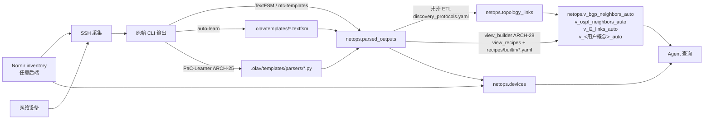
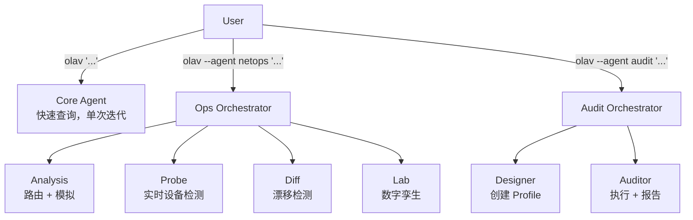

# 核心概念

OLAV NetOps 如何采集、存储和分析你的网络。

!!! abstract "功能声明"
    | ID | 声明 | 状态 |
    |----|------|------|
    | C-NE-05 | 每次快照生成唯一 `snapshot_id`，所有表行共享 | ✅ v0.10.0 |
    | C-NE-06 | 自定义 TextFSM 模板优先于 NTC 内置模板 | ✅ v0.10.0 |
    | C-NE-07 | `CommandRegistry.reload()` 不重启即加载新模板 | ✅ v0.10.0 |

---

## 数据流



每次采集产生一个**快照** —— 所有设备状态的时间点捕获。数据库每一行都携带 `snapshot_id`,关联到具体采集时刻。

几份 YAML + 一个 DB 表驱动整条流水线，都不在 Python 代码里：

| 文件 / 表 | 作用 |
|------|------|
| Nornir inventory(任意后端) | 设备清单 + `platform` + `hostname` + `environment` |
| `netops.commands`(DB 表) | **每平台 CLI 命令的 SSOT。** `/netops_init` Stage 0 扫描 ntc-templates 文件名自动填充，取代旧的 `discovery_commands.yaml`。 |
| `user_commands.yaml` | 仅做 backup 原始抓取(show run / show config) —— workspace 默认值 + 可选 `~/.olav/config/` 覆盖 |
| `discovery_protocols.yaml` | 拓扑发现协议(CDP/LLDP/ISIS/自定义) |
| `platform_profiles.yaml` | 厂商显示名 + show-version 字段提示 + Scrapli 映射 |
| `recipes/builtin/*.yaml` + `~/.olav/config/recipes/user/*.yaml` | 归一概念 → 原始字段的映射，决定 SQL 视图 |
| `~/.olav/config/topology.yaml` | 用户意图 —— 关心哪些关系 |

---

## 快照模型

快照是网络状态的基本单位。运行 `/netops_init` 或手动采集时，OLAV 执行：

1. **采集** — SSH 连接 `nornir/hosts.yaml` 中的每台设备，运行所有白名单 show 命令
2. **解析** — 使用 TextFSM 模板从原始 CLI 输出提取结构化字段
3. **存储** — 解析后的 JSON 写入 `netops.parsed_outputs`，原始文本写入 `netops.raw_output_store`
4. **衍生** — 自动生成视图（`v_*_auto`）和拓扑链接

同一次采集的所有行共享相同的 `snapshot_id`。这使时间序列比较变得简单：选择两个 snapshot ID 即可 diff 任意表。

---

## Batfish 快照导出

每次 `/netops_init` 还会把 Batfish 兼容的配置快照落到磁盘，可以直接喂给 `pybatfish` 或任意基于 Batfish 的分析流水线，不必再从 DuckDB 重新解析：

```
exports/snapshots/<YYYY-MM-DD>/batfish/
├── configs/
│   ├── R1.cfg
│   ├── R2.cfg
│   └── SW1.cfg
└── snapshot.json        # 溯源信息：生成器、时间戳、设备列表
```

`exports/snapshots/latest-batfish` 符号链接始终指向最新一次导出。"哪条命令承载 running-config" 的平台映射从 `user_commands.yaml` 解析（默认值已对齐 Batfish 偏好 —— 例如 Junos 用 `show configuration | display set`）。

---

## TextFSM 模板优先级

解析 CLI 输出时，OLAV 按以下顺序查找匹配模板：

| 优先级 | 位置 | 来源 |
|--------|------|------|
| 1（最高） | `workspace/ops/config/textfsm/` | 用户自定义覆盖 |
| 2 | `workspace/ops/config/templates/custom/` | `/learn_cmd` 生成 |
| 3 | `workspace/ops/config/templates/` | 内置默认模板 |
| 4（最低） | `ntc-templates` Python 包 | 社区模板 |

第一个匹配生效。要覆盖内置模板，将同名文件（`<platform>_<command>.textfsm`）放入优先级 1 或 2。

---

## Agent 层级



| Agent | 使用场景 | 访问设备？ |
|-------|---------|-----------|
| **Quick** | 简单问题、日常查询 | 是（单设备 CLI） |
| **Ops → Analysis** | What-if 模拟、路径分析 | 否（纯计算） |
| **Ops → Probe** | 批量活性检测、并行 CLI | 是（并行） |
| **Ops → Diff** | 比较两次快照差异 | 否（DB 查询） |
| **Ops → Lab** | 部署前在 ContainerLab 验证 | 仅 CLAB API |
| **Audit** | 合规检查、健康报告 | 否（DB 查询） |

---

## 命令安全

在网络设备上执行的每条 CLI 命令都经过两道门禁：

1. **白名单** — 仅 `commands` 表中注册的命令（在 `/netops_init` 期间填充）被允许
2. **黑名单** — `blacklisted_commands.yaml` 中的正则 pattern 即使在白名单中也会被拒绝

这确保 agent 不能在生产设备上运行任意命令。详见 [配置](configuration.md)。
