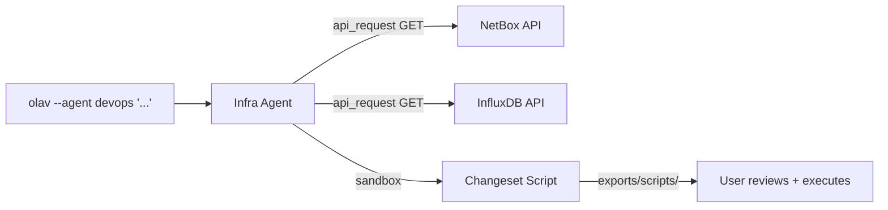

# Infra Agent

!!! note "`infra` is a sub-agent of `devops`, not a top-level agent"
    There is no `olav --agent devops`. Infrastructure queries run under the
    `devops` agent (`olav --agent devops`), which delegates to its `infra`
    sub-agent. Commands below using `--agent devops` should use
    `--agent devops`.

The Infra capability queries external infrastructure management systems — NetBox, InfluxDB, and any API registered via `olav registry register`. It has zero proprietary tools: everything comes from core platform inheritance.

!!! abstract "Feature Claims"
    | ID | Claim | Status |
    |----|-------|--------|
    | C-NE-36 | `olav registry register` registers a service and generates API reference markdown | ✅ v0.12.0 |
    | C-NE-37 | `olav --agent devops` queries registered services via `api_request` | ✅ v0.13.1 |
    | C-NE-38 | `api_request` returns a clear error for unregistered services | ✅ v0.12.0 |
    | C-NE-39 | Write operations require `--enable-api-write` + dry-run + mandatory approval | ✅ v0.13.1 |
    | C-NE-40 | `network_isolation=True` sandbox hard-blocks HTTP write operations | ✅ v0.12.0 |

    *Legend: ⚠️ (E2E-gated) = test exists but requires env-var flag, skipped in CI; ⚠️ (manual) = demo-verified only, no automated CI test*

---

## Architecture

Infra is a **zero-tool agent**. It inherits everything from core:

| Inherited Tool | Usage |
|---------------|-------|
| `api_request` | Query any registered service (GET) |
| `format_and_export` | Export changeset scripts to `exports/scripts/` |
| `execute_sql` | Query DuckDB snapshot data |



---

## Registering a Service

Before Infra can query a service, register it:

```bash
olav registry register http://netbox:8000 --auth-type bearer --token-env NETBOX_TOKEN
```

This:
1. Adds the service to `services.yaml` (readonly by default)
2. Parses the OpenAPI schema
3. Generates a condensed API reference in `infra/references/<service>_api.md`

The reference is loaded as static context — the agent knows which endpoints exist and what parameters they accept.

---

## Querying Services

```bash
olav --agent devops "List all devices in NetBox site DC1"
```

The agent translates this to:

```python
api_request(service="netbox", path="/api/dcim/devices/", params={"site": "DC1"})
```

Auth (JWT, API key, Bearer token) is handled automatically by the platform based on `services.yaml` configuration.

---

## Bulk Change Scripts (Changeset Mode)

For write operations, Infra generates scripts instead of executing directly:

```bash
olav --agent devops "Update all planned devices in DC1 to active status"
```

The agent:
1. **Reads** current state via `api_request` (GET only)
2. **Computes** the changeset (diff observed state against the desired state)
3. **Validates** conflicts (duplicate IPs, missing dependencies)
4. **Exports** to `exports/scripts/changeset-netbox-<date>.sh`

```bash
# Review the generated script
cat .olav/exports/scripts/changeset-netbox-2026-04-08.sh

# Execute manually after review
NETBOX_TOKEN=abc123 bash .olav/exports/scripts/changeset-netbox-2026-04-08.sh
```

The agent **never** executes write API calls. Even if the LLM attempts it:
- `api_request` passes `confirmed=False` — write ops require HITL approval
- Sandbox `hard_block` prevents HTTP mutations under network isolation
- `services.yaml` `readonly_only: true` blocks writes at the service level

---

## Safety

Five layers prevent unauthorized API writes:

| Layer | Defense |
|-------|---------|
| System prompt | "NEVER attempt method != GET" |
| `api_request` | `confirmed=False` → requires_approval |
| `sandbox_guard` | `hard_block` under network_isolation |
| `unshare --net` | Physical network isolation |
| `services.yaml` | `readonly_only: true` per service |
