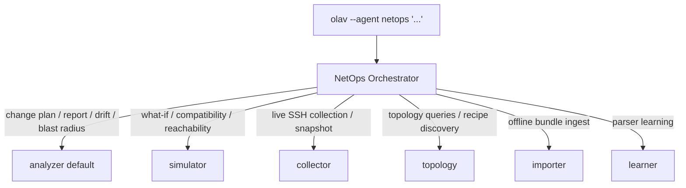

# NetOps Agent

The NetOps Agent (`olav --agent netops`) is a thin orchestrator for deep
network operations. It routes your request to **one** specialist sub-agent and
returns that sub-agent's result verbatim — it routes, it does not do data work.

!!! abstract "Feature Claims"
    | ID | Claim | Status |
    |----|-------|--------|
    | C-NE-20 | `olav --agent netops "plan a change"` routes to the analyzer sub-agent | ✅ v0.13.1 |
    | C-NE-21 | `olav --agent netops "check all devices"` routes to the collector sub-agent | ✅ v0.13.1 |

    *Legend: ⚠️ (E2E-gated) = test exists but requires env-var flag, skipped in CI; ⚠️ (manual) = demo-verified only, no automated CI test*

---

## Architecture

```bash
olav --agent netops "your question"
```

The orchestrator detects intent and delegates to one of **six** sub-agents.
**`analyzer` is the default.**



| Sub-agent | Specialization | Network access |
|-----------|----------------|----------------|
| [analyzer](analyzer.md) **(default)** | Change-plan drafting, investigation reports, drift/diff, L2 blast-radius | None (reads DB) |
| [simulator](simulator.md) | Batfish config-layer evaluation — BGP/OSPF compatibility, reachability, route/ACL/policy, what-if | None (Batfish) |
| [collector](collector.md) | Live data collection — parallel CLI / Nornir, liveness + latency, snapshots | Yes (SSH to devices) |
| [topology](topology.md) | Topology queries (BGP/OSPF/CDP-LLDP/L2) + LLM-assisted recipe discovery | None (reads DB) |
| [importer](importer.md) | Offline ingest — bundle / rancid backup / vendor dump | None (file input) |
| [learner](learner.md) | Parser-layer learning — draft a TextFSM / Python parser for unparsed CLI output | None |

---

## Routing Logic

The orchestrator uses intent detection to pick the right sub-agent:

| Your question contains... | Routes to |
|---------------------------|-----------|
| "plan", "add", "change", "modify", "变更", "new eBGP", "investigate", "report", "what changed", "drift", "blast radius" | analyzer |
| "simulate", "what if", "compatibility", "would BGP come up", "reachable", "route lookup", "ACL / route-map" | simulator |
| "check", "ping", "alive", "reachable", "run command on", "take a snapshot" | collector |
| "topology", "neighbors", "what connects to", "shortest path" | topology |
| "import", "ingest this bundle", "rancid", "vendor dump", "导入", "离线" | importer |
| "the parser missed", "learn this command", "no template" | learner |

For ambiguous requests, the orchestrator may ask a clarifying question or use
multiple sub-agents in sequence. Sub-agents are also invoked directly via
`task("<name>", "<request>")` — e.g. the analyzer delegates a config-layer
what-if with `task("simulator", "…")`.

---

## Tools

The orchestrator itself carries only the cross-domain tools
(`olav_recall_memory`, `olav_store_memory`, `web_search`) — it routes, it does
not do data work. **Each sub-agent declares its own tool set** (e.g. collector
has `execute_cli_parallel` / `take_snapshot`; analyzer has
`generate_change_plan`). There is no shared orchestrator-inherited tool pool;
see each sub-agent's page for its tools.
