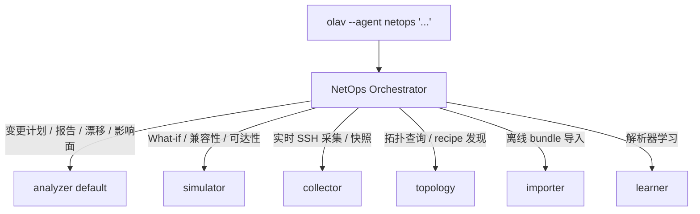

# NetOps Agent

NetOps Agent（`olav --agent netops`）是深度网络运维的轻量编排器。它把请求路由到
**一个**专家子 agent，并原样返回该子 agent 的结果 —— 它只做路由，不做数据工作。

!!! abstract "功能声明"
    | ID | 声明 | 状态 |
    |----|------|------|
    | C-NE-20 | `olav --agent netops "规划一个变更"` 路由到 analyzer 子 agent | ✅ v0.13.1 |
    | C-NE-21 | `olav --agent netops "检查所有设备"` 路由到 collector 子 agent | ✅ v0.13.1 |

    *说明：⚠️ (E2E门控) = 测试已存在但需要特殊环境变量，CI 不运行；⚠️ (手动) = 仅演示验证，无 CI 自动化测试*

---

## 架构

```bash
olav --agent netops "你的问题"
```

编排器检测意图，委托给**六个**子 agent 之一。**`analyzer` 是默认。**



| 子 Agent | 专长 | 网络访问 |
|----------|------|---------|
| [analyzer](analyzer.md) **（默认）** | 变更计划起草、调查报告、漂移/diff、L2 影响面 | 无（读 DB） |
| [simulator](simulator.md) | Batfish 配置层评估 —— BGP/OSPF 兼容性、可达性、路由/ACL/策略、what-if | 无（Batfish） |
| [collector](collector.md) | 实时采集 —— 并行 CLI / Nornir、活性 + 时延、快照 | 有（SSH） |
| [topology](topology.md) | 拓扑查询（BGP/OSPF/CDP-LLDP/L2）+ LLM 辅助 recipe 发现 | 无（读 DB） |
| [importer](importer.md) | 离线导入 —— bundle / rancid 备份 / 厂商导出 | 无（文件输入） |
| [learner](learner.md) | 解析器层学习 —— 为未解析 CLI 输出起草 TextFSM / Python 解析器 | 无 |

---

## 路由逻辑

编排器通过意图检测选择子 agent：

| 问题包含... | 路由到 |
|------------|--------|
| "规划"、"添加"、"变更"、"新 eBGP"、"调查"、"报告"、"什么变了"、"漂移"、"影响面" | analyzer |
| "模拟"、"如果"、"兼容性"、"BGP 会起来吗"、"可达"、"路由查找"、"ACL / route-map" | simulator |
| "检查"、"ping"、"可达"、"在...上执行"、"打快照" | collector |
| "拓扑"、"邻居"、"什么连到"、"最短路径" | topology |
| "导入"、"导入这个 bundle"、"rancid"、"厂商导出"、"离线" | importer |
| "解析器漏了"、"学习这个命令"、"没有模板" | learner |

对于模糊请求，编排器可能询问澄清问题或依次使用多个子 agent。子 agent 也可通过
`task("<name>", "<请求>")` 直接调用 —— 例如 analyzer 用 `task("simulator", "…")`
委托配置层 what-if。

---

## 工具

编排器自身只带跨域工具（`olav_recall_memory`、`olav_store_memory`、
`web_search`）—— 它只做路由，不做数据工作。**每个子 agent 声明自己的工具集**
（如 collector 有 `execute_cli_parallel` / `take_snapshot`；analyzer 有
`generate_change_plan`）。没有编排器继承的共享工具池，详见各子 agent 页面。
